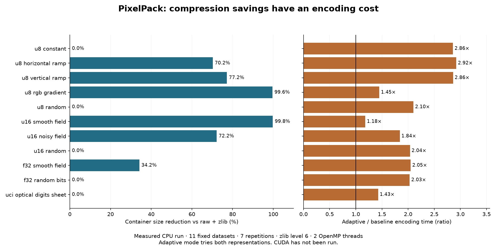

# PixelPack Lab

**A small, inspectable C++17 image/data-processing prototype: reversible prediction, byte-plane shuffling, and CPU DEFLATE.**



This project investigates a narrow engineering question: **when can a reversible, parallelizable preprocessing transform reduce the size of image/scientific data before a standard compressor, and what does it cost?**

It is a portfolio experiment, not a new entropy coder, a production image format or an NVIDIA product. DEFLATE is provided by **zlib**, not implemented from scratch. The optional CUDA path accelerates only the reversible transform; it does not implement GPU DEFLATE.

## Current, measured status

- CPU C++17 implementation compiled and run on Linux x86-64, GCC 14.2.0; OpenMP build with two threads.
- **15 Python unittest methods passed**, including independent NumPy-oracle comparisons and parameterized subcases.
- **81 native shape/type combinations passed under AddressSanitizer and UndefinedBehaviorSanitizer.**
- Eleven fixed datasets, three encoding modes, seven measured repetitions after warm-up, exact-byte reconstruction checks.
- The complete containers occupied **4,772,254 baseline bytes versus 3,181,673 adaptive bytes: 33.33% smaller** across this particular mixed suite.
- The UCI digits sheet and random inputs showed **no adaptive size benefit**. Adaptive encoding performs two compression passes and is generally slower. These results are retained, not hidden.
- **CUDA code is provided but NOT compiled, executed or benchmarked yet.** There is no NVIDIA GPU or CUDA compiler in the authoring environment. No GPU speedup is claimed.
- GitHub Actions definitions cover Linux, macOS and OpenMP. Their cloud runs are **pending publication**, not already passed.

Read [the measured report](reports/BENCHMARK.md), [raw JSON](reports/cpu_results.json), and [design notes](DESIGN.md).

## What is implemented

1. Accept packed HWC arrays with 1–4 channels: uint8, uint16 or float32.
2. Normalize sample byte order to little-endian, and bound decoded size to 256 MiB.
3. Predict each sample from the previous row, within the same column/channel:
   - uint8/uint16: unsigned modular difference;
   - float32: XOR of the underlying 32-bit patterns; no floating-point arithmetic.
4. Shuffle residual bytes into contiguous byte planes.
5. Compress either the original bytes, transformed bytes, or both, using zlib level 6.
6. Store the selected payload with dimensions, dtype, predictor flag, length and CRC32.
7. Validate the container, decompress, invert the transform and verify reconstructed pixels.

The 32-bit bit-preserving path handles signed zero, infinities, subnormals and distinct NaN payloads without a numerical approximation. This is **not** evidence of advanced floating-point error analysis.

## Run on your MacBook

Apple Silicon Macs can run the CPU version. They cannot run NVIDIA CUDA locally.

```bash
# Once, if command-line build tools are missing:
xcode-select --install

# Inside the extracted pixelpack-lab folder:
python3 -m venv .venv
source .venv/bin/activate
python -m pip install -r requirements.txt
make
make test
make sanitize
python tools/benchmark.py
python tools/plot_results.py
```

`make` uses the system C++ compiler and zlib. On macOS the default build is serial. The benchmark records your compiler, build command and environment. Run `make clean` before changing build flags. Numbers will differ from the supplied Linux run.

Linux with OpenMP:

```bash
make clean
make OPENMP=-fopenmp
OMP_NUM_THREADS=2 OPENBLAS_NUM_THREADS=1 python -m unittest discover -s tests -v
make sanitize
OMP_NUM_THREADS=2 OPENBLAS_NUM_THREADS=1 python tools/benchmark.py
```

### Try an image

```bash
python pixelpack.py pack input.png packed.ppl
python pixelpack.py unpack packed.ppl restored.png
```

Pillow imports/exports pixel arrays. The prototype preserves pixels, **not original PNG/TIFF files or metadata**. It does not parse JPEG/TIFF internals, implement JPEG coding, or claim better performance than those formats. Use supported uint8, uint16 grayscale, or supported float32 TIFF pixel types. Palette/metadata semantics are outside scope.

## Run the CUDA verification on an NVIDIA machine

Use a Linux machine with NVIDIA GPU, compatible driver, CUDA toolkit and `nvcc`:

```bash
make
make cuda
./build/cuda_validate | tee gpu-results.local.txt
compute-sanitizer --tool memcheck ./build/cuda_validate
```

The harness compares GPU forward output to the CPU reference and GPU inverse output to the exact source across **81** shape/type combinations, including widths that do not divide the block size. Only its forward-kernel time is measured with CUDA events, after warm-up; host copies and allocations are excluded. Never label that as end-to-end compression speedup. Save the actual output, hardware/toolkit versions and sanitizer result before changing the CUDA status.

## Publish to GitHub

1. Review the source, run the CPU checks above and read `INTERVIEW_NOTES.md`.
2. Create an empty **public** repository named `pixelpack-lab` on your GitHub account. Do not pre-add a README or licence.
3. From this project folder, run:

```bash
git init -b main
git add README.md DESIGN.md INTERVIEW_NOTES.md LICENSE Makefile requirements.txt pixelpack.py src cuda tests tools reports .github .gitignore
git commit -m "Add lossless image preprocessing prototype and measured CPU benchmark"
git remote add origin https://github.com/MahdiBayanloo/pixelpack-lab.git
git push -u origin main
```

These commands are for the new extracted folder and a new empty repository. If Git reports an existing remote or history, stop and inspect it rather than force-pushing. The supplied archive contains no credentials or compiled binaries. After publication, wait for CI and inspect the actual results.

## Development provenance and ownership

Prepared for Mahdi Bayanloo in November 2026 through an AI coding assistant, including the initial implementation, tests and Linux measurements. Mahdi requested the project and its scope. At delivery, his local review, reproduction, modifications, GitHub publication and GPU validation are still pending.

Do not describe this as prior employment, long-running research, sole unaided implementation, a deployed service, a handwritten DEFLATE codec or a GPU-validated library. Keep a short record of your review, defects you identify, changes you make and your own measured results; those are your strongest interview evidence. The project may be used in a CV as a new AI-developed portfolio prototype with the actual validation status stated.

## Dependencies and data

- Python dependencies: NumPy, Pillow, scikit-learn and Matplotlib, installed from `requirements.txt`.
- C++ dependencies: C++17 compiler and system zlib; OpenMP optional.
- Ten deterministic synthetic datasets plus the bundled scikit-learn UCI optical digits dataset (all 1,797 8×8 images in a padded mosaic). **This dataset is not MNIST.** No private or employer data.
- [zlib API documentation](https://www.zlib.net/manual.html)
- [NVIDIA CUDA kernel programming](https://docs.nvidia.com/cuda/cuda-programming-guide/02-basics/writing-cuda-kernels.html)
- [scikit-learn load_digits](https://scikit-learn.org/stable/modules/generated/sklearn.datasets.load_digits.html)
- [UCI Optical Recognition of Handwritten Digits](https://archive.ics.uci.edu/dataset/80/optical+recognition+of+handwritten+digits)

## Limitations and useful next work

No native image-format parser, GPU entropy coder, streaming API, GPU/CPU transfer analysis, performance portability claim or production security audit. A per-column inverse has limited GPU parallelism for narrow images; a parallel prefix-scan inverse is a possible future experiment, not implemented here. Useful next measurements are independent per-image digits (not just a mosaic), representative public medical/scientific images, chunked selection, serial-versus-OpenMP scaling, and end-to-end GPU timings including transfers.
